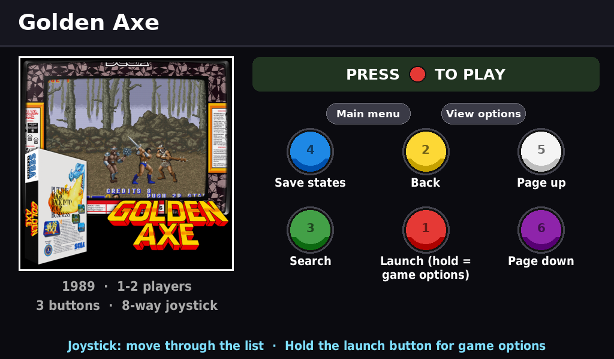
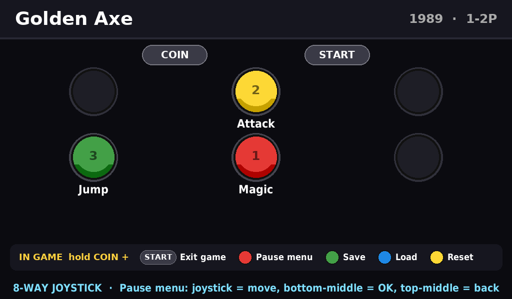
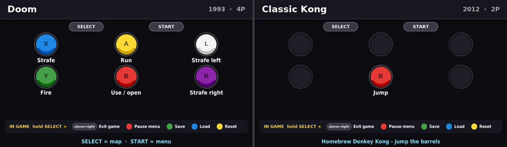

# batocera-button-cards

A small second screen on your arcade cabinet that shows **what every button does — for the game you are about to play**.

Built on a real Batocera cabinet with the help of an AI assistant (Claude) working over SSH. The scripts discover almost
everything from the cabinet's own configuration, so you can adapt them to your own button layout and USB encoder —
ideally with your favourite LLM doing the SSH legwork for you.

| Browsing the menu | Playing |
|---|---|
|  |  |



## What it does

- **Browse card** (game highlighted in the menu): screenshot, year, players, how many buttons, and how to use the menu
  (launch, back, search, save states, main menu, view options).
- **In-game card** (game launched): every button labelled in *your* panel's physical layout, plus the hotkey combos
  (exit, pause menu, save, load, reset) read from RetroArch.
- **Menu card** (browsing systems): how to drive EmulationStation.
- Works for every system on the cabinet: MAME, consoles (SNES, NES, Mega Drive, PC Engine, GBA, C64 …) and ports
  (Doom, Prince of Persia, …).

## How it works

```
press wizard ──► panel.json  (position ──► evdev key code, recorded once per cabinet)
                     │
EmulationStation es_input.cfg ──► menu functions per position
RetroArch retroarchcustom.cfg ──► RetroPad buttons + hotkeys per position
/usr/share/evmapy/*.keys      ──► hotkeys of ports not run by RetroArch
configgen defaults            ──► which emulator/core each system uses
data/profiles.json            ──► per core: RetroPad ──► button names on the original hardware
data/community-labels.csv     ──► per game: native button ──► what it does
                     │
              cardgen.py (Pillow, runs on the cabinet) ──► one PNG per game & phase
                     │
EmulationStation events (game-selected / game-start / game-end) ──► cardview-show ──► mpv on the 2nd screen
```

## Requirements

- Batocera (built and tested on **v38**, x86_64) with SSH enabled.
- A second display (tested: 7" 1024×600 HDMI screen on the PC's 2nd HDMI port; touch not needed).
- Python 3 + Pillow and mpv — both already ship with Batocera.
- A computer with SSH (and optionally an LLM assistant that can run commands for you).

## Quick start

See **[docs/ARTICLE.md](docs/ARTICLE.md)** for the full step-by-step write-up, and **[docs/LLM-GUIDE.md](docs/LLM-GUIDE.md)**
for a briefing you can hand to your own AI assistant. In short:

```bash
# 1. build the label database (on your computer)
python3 tools/build_gamedb.py
# 2. copy the repo to the cabinet
scp -r . root@<cabinet-ip>:/userdata/system/batocera-button-cards
# 3. record your panel: run the wizard ON the cabinet and press each player-1 button once, in the order shown
ssh -t root@<cabinet-ip> python3 /userdata/system/batocera-button-cards/cabinet/bin/wizard.py --out /userdata/system/cardview/panel.json
#    other layouts:  --rows 4,4  (8 buttons)   --rows 3,3,2   --above 2 (coin/start)   --compare (check player 2)
# 4. install (renders all cards and starts the viewer on the 2nd screen)
ssh root@<cabinet-ip> /userdata/system/batocera-button-cards/cabinet/install.sh
```

Joystick-type encoders (DragonRise "zero delay", Xin-Mo, …) and keyboard-type encoders (I-PAC, …) are both supported:
the wizard records whichever device you press.

Then hide the games your controls can't play (wheel, yoke, twin-stick, spinner, trackball…) — reversible:

```bash
ssh root@<cabinet-ip> python3 /userdata/system/cardview/bin/playable.py --apply
```

## Extras

- `cabinet/extras/wifiwatchdog` — optional Batocera service. Some Wi-Fi adapters come up and go straight back down at
  boot and never connect until the network settings are re-saved; this checks for an IP address for a few minutes after
  boot and reconnects (copy to `/userdata/system/services/`, then `batocera-services enable wifiwatchdog`).

## Button names — help wanted

Button names live in **[data/community-labels.csv](data/community-labels.csv)**, one row per game and button, with the
**source** of every label. Many came from best knowledge and need confirming — see **[CONTRIBUTING.md](CONTRIBUTING.md)**.

## Roadmap

See [ROADMAP.md](ROADMAP.md) — next up: trackball, spinner, wheel and yoke cabinets.

## License

MIT — see [LICENSE](LICENSE). Button-name research uses MAME and MAME 2003-Plus source code and the Arcade History
database as references. Game names, logos and screenshots belong to their owners: the cards use the media already
scraped on your own cabinet, and the example images in `docs/images` are only illustrations.
